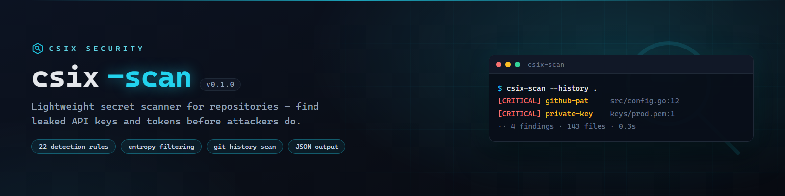

# csix-scan



**Pemindai rahasia (secret scanner) ringan untuk repository — murni Go, nol dependency, single binary.**

> English documentation: [README.md](README.md)

## Apa ini?

`csix-scan` mendeteksi API key, token, kredensial, dan private key yang
tertanam di file atau **riwayat commit git** — sebelum penyerang menemukannya
lebih dulu. Cocok dipakai sebagai gerbang CI agar rahasia tak pernah
ter-push ke GitHub.

## Instalasi

```sh
go install github.com/siedysoes/csix-scan@latest
```

## Penggunaan

```sh
csix-scan .                    # pindai direktori saat ini
csix-scan --history .          # termasuk riwayat commit git
csix-scan --json .             # output JSON untuk CI
```

**Exit code:** `0` bersih · `1` ditemukan rahasia · `2` error

## Checklist Sebelum Push ke GitHub

1. Ganti `siedoyses`/`siedysoes` di `go.mod`, `main.go`, dan README
   dengan username GitHub Anda sendiri (jika berbeda).
2. Buat repo baru bernama `csix-scan` di akun Anda.
3. Push folder ini ke repo tersebut.
4. Aktifkan tab **Actions** di repo (CI otomatis jalan).

## Lisensi

MIT. Gunakan hanya untuk audit keamanan milik Anda sendiri.
