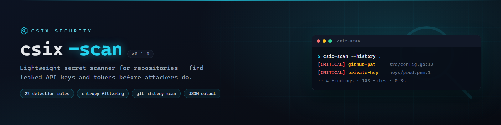

# csix-scan



**Lightweight secret scanner for your repository — pure Go, zero dependencies, single binary.**

[](https://github.com/siedysoes/csix-scan/actions/workflows/ci.yml)
[](https://github.com/siedysoes/csix-scan/releases)
[](LICENSE)

`csix-scan` detects API keys, tokens, credentials, and private keys embedded
in files or your **git commit history** — before attackers find them first.
JSON output and built-in exit codes make it easy to use as a CI gate.

## Features

- 🔍 **22 detection patterns**: AWS, GitHub, GitLab, Slack, Google, Stripe, OpenAI,
  Twilio, SendGrid, npm, Telegram, Mailgun, JWT, private keys (PEM),
  DB connection strings, basic-auth URLs, and generic assignments
- 🧠 **Shannon entropy validation** + placeholder filtering to reduce false positives
- 📜 **Commit history scanning** (`--history`) — secrets that ever entered git
  are still detected even after being removed from files
- 🎨 Colored output, secret values **masked by default**
- 📦 `--json` for tooling/CI integration
- ⚡ Single binary, no runtime, no network access

## Installation

### Prebuilt binaries

Download the latest binary for your platform from the
[Releases page](https://github.com/siedysoes/csix-scan/releases/latest)
(Windows / Linux / macOS, amd64 + arm64), then verify it:

```sh
sha256sum -c checksums.txt
```

### Go

```sh
go install github.com/siedysoes/csix-scan@latest
```

### Build from source

```sh
git clone https://github.com/siedysoes/csix-scan
cd csix-scan
go build -o csix-scan .
```

## Usage

```sh
# scan the current directory
csix-scan .

# scan a specific directory + git commit history
csix-scan --history ./your-project

# JSON output for CI
csix-scan --json .
```

Example output:

```
csix-scan v0.1.0 — lightweight secret scanner for your repository
target: C:\projects\backend

[CRITICAL] github-pat               src/config.go:12
           secret: ghp_****...b3fA
[CRITICAL] private-key              keys/prod.pem:1
           secret: -----B...KEY-----

── 2 findings (critical 2, high 0, medium 0) · 143 files scanned · 0.3s
```

## Options

| Flag | Description |
|------|-------------|
| `--history` | Also scan git commit history |
| `--json` | JSON output |
| `--show-secrets` | Print raw secret values (default: masked) |
| `--exclude <a,b>` | Extra directory names to skip (comma-separated) |
| `--max-file-mb <n>` | Max file size to scan (default 10 MB) |
| `--no-color` | Disable colored output (also honors `NO_COLOR`) |
| `--version` | Print version |

**Exit codes:** `0` clean · `1` secrets found · `2` error

## CI Integration

```yaml
- name: Scan for leaked secrets
  run: |
    go install github.com/siedysoes/csix-scan@latest
    csix-scan --history .
```

## Notes

This is a **heuristic** tool. It can produce false positives — findings must
be reviewed by a human and should not be treated as confirmed leaks outright.
Always verify before deciding a token is truly secret.

## Languages

- English (this file)
- [Bahasa Indonesia](README.id.md)

## License

MIT — see [LICENSE](LICENSE). Use for defensive purposes and auditing of
your own assets only.
